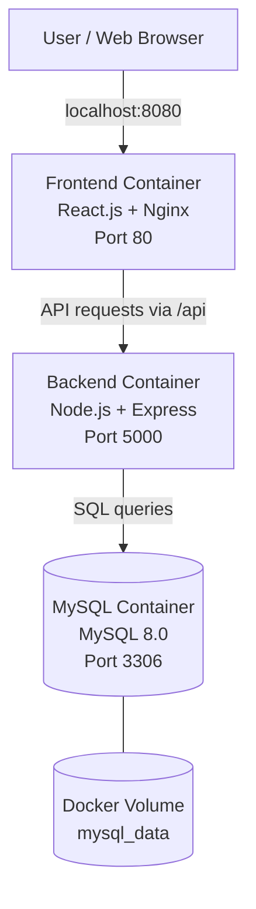
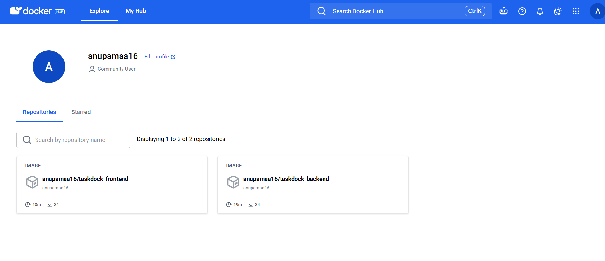
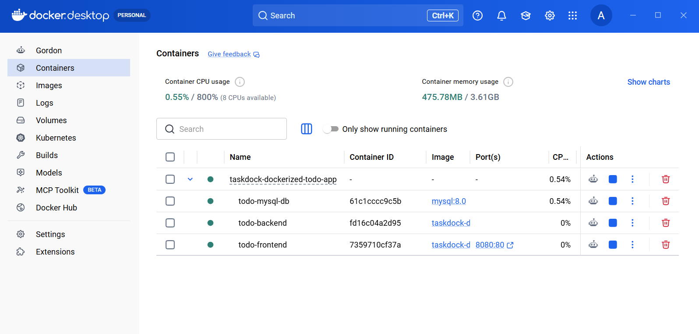
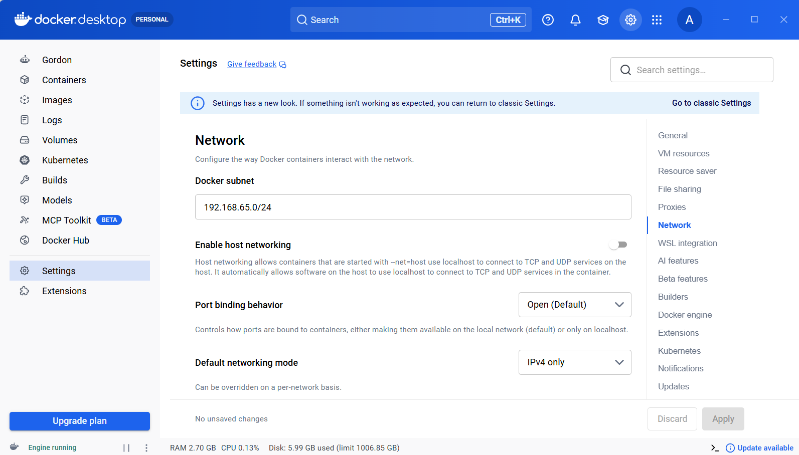
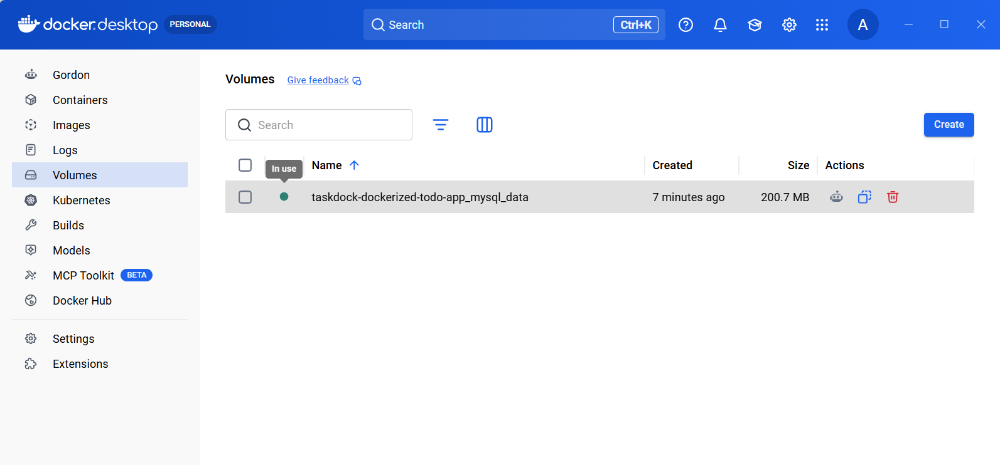
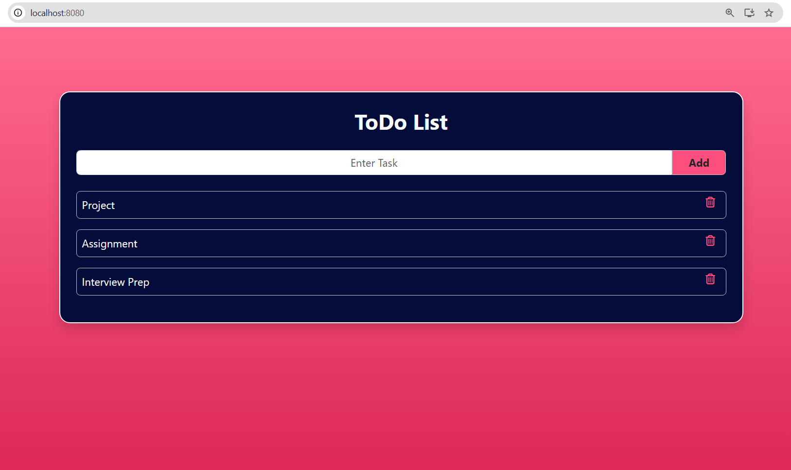

# TaskDock – Dockerized Three-Tier To-Do List Application

A three-tier To-Do List web application containerized using **Docker and Docker Compose**. The application uses React.js for the frontend, Node.js and Express.js for the backend, and MySQL 8.0 for database management.

This project demonstrates practical implementation of Docker images, container orchestration, inter-container networking, persistent storage, and Nginx reverse proxy configuration.

## Table of Contents

- [Project Overview](#project-overview)
- [Key Features](#key-features)
- [Technology Stack](#technology-stack)
- [Architecture](#architecture)
- [Docker Implementation](#docker-implementation)
- [Docker Images](#docker-images)
- [Docker Containers](#docker-containers)
- [Networking and Persistent Storage](#networking-and-persistent-storage)
- [Repository Structure](#repository-structure)
- [Application Screenshots](#application-screenshots)
- [Run Locally](#run-locally)
- [Docker Commands](#docker-commands)
- [Security Notes](#security-notes)

## Project Overview

TaskDock is a containerized three-tier web application that allows users to add, view, and delete tasks.

The main focus of this project is to understand how a multi-tier application can be containerized and managed using Docker.

Each application component runs in a separate container, with Docker Compose managing the services and their communication.

## Key Features

- Add new tasks to the To-Do List.
- View all saved tasks.
- Delete existing tasks.
- Store task information in a MySQL database.
- Containerize the frontend and backend using custom Docker images.
- Manage multiple containers using Docker Compose.
- Enable communication between containers through a custom Docker network.
- Maintain database persistence using Docker volumes.
- Use Nginx as a reverse proxy for backend API requests.

## Technology Stack

| Area | Technology |
|---|---|
| Frontend | React.js |
| Backend | Node.js, Express.js |
| Database | MySQL 8.0 |
| Containerization | Docker |
| Container Orchestration | Docker Compose |
| Web Server | Nginx |
| Networking | Docker Bridge Network |
| Storage | Docker Volumes |
| Version Control | Git, GitHub |
| Image Registry | Docker Hub |

## Architecture

TaskDock follows a three-tier architecture consisting of the frontend, backend, and database.



### Application Flow

1. The user accesses the application through the browser.
2. Nginx serves the React frontend.
3. Frontend API requests are forwarded to the Node.js backend through Nginx.
4. The backend processes requests and communicates with MySQL.
5. MySQL stores and retrieves task information.

## Docker Implementation

### 1. Custom Docker Images

Created separate Dockerfiles for the frontend and backend.

- **Frontend:** Used a multi-stage Docker build with Node.js to build the React application and Nginx to serve the production build.
- **Backend:** Created a custom Docker image using Node.js to run the Express application.
- **Database:** Used the official MySQL 8.0 Docker image.

### 2. Docker Compose

Used Docker Compose to define and manage all three application services through a single `docker-compose.yml` file.

The configuration includes:

- Service definitions and dependencies.
- Environment variables for database configuration.
- Port mapping for frontend access.
- Custom bridge network.
- Persistent database volume.
- MySQL health check.

### 3. Nginx Reverse Proxy

Configured Nginx to serve the React application and forward API requests to the backend container.

This allows the frontend to communicate with the backend without exposing the backend port directly to the host.

## Docker Images

Created custom Docker images for the frontend and backend and published them to Docker Hub.

| Component | Docker Hub Image | Tag |
|---|---|---|
| Frontend | [anupamaa16/taskdock-frontend](https://hub.docker.com/r/anupamaa16/taskdock-frontend) | `latest` |
| Backend | [anupamaa16/taskdock-backend](https://hub.docker.com/r/anupamaa16/taskdock-backend) | `latest` |
| Database | Official MySQL image | `mysql:8.0` |

### Docker Hub Repositories

**Frontend Image**

[View Frontend Image on Docker Hub](https://hub.docker.com/r/anupamaa16/taskdock-frontend)

```bash
docker pull anupamaa16/taskdock-frontend:latest
```

**Backend Image**

[View Backend Image on Docker Hub](https://hub.docker.com/r/anupamaa16/taskdock-backend)

```bash
docker pull anupamaa16/taskdock-backend:latest
```

### Published Docker Images



## Docker Containers

The application runs using three separate containers:

| Container | Service | Purpose |
|---|---|---|
| todo-frontend | Frontend | Serves the React application through Nginx |
| todo-backend | Backend | Handles API requests and application logic |
| todo-mysql-db | MySQL | Stores application data |

### Running Containers in Docker Desktop



## Networking and Persistent Storage

### Docker Network

Created a custom bridge network named `todo-network` to enable communication between the frontend, backend, and MySQL containers.

The backend connects to MySQL using the service hostname `mysql`, while Nginx forwards API requests to the backend using the hostname `backend`.

### Docker Volume

Configured a named Docker volume called `mysql_data` to persist MySQL database files.

This ensures that database records remain available even after the containers are stopped and removed using `docker compose down`.

### Docker Network Screenshot



### Docker Volume Screenshot



## Repository Structure

```text
taskdock-dockerized-todo-app/
│
├── backend/
│   ├── .dockerignore
│   ├── Dockerfile
│   ├── index.js
│   ├── package.json
│   └── package-lock.json
│
├── database/
│   └── init.sql
│
├── frontend/
│   └── react-todo/
│       ├── public/
│       ├── src/
│       ├── .dockerignore
│       ├── Dockerfile
│       ├── nginx.conf
│       ├── package.json
│       └── package-lock.json
│
├── docs/
│   └── images/
│
├── .gitignore
├── docker-compose.yml
└── README.md
```

## Application Screenshots

### TaskDock – Running Application



## Run Locally

### Prerequisites

- Docker Desktop
- Git
- Docker Hub account (only if pulling the published images)

### Step 1: Clone the repository

```bash
git clone https://github.com/Anupama-A16/taskdock-dockerized-todo-app.git
cd taskdock-dockerized-todo-app
```

### Step 2: Configure environment variables

Create a `.env` file in the project root directory.

```env
MYSQL_ROOT_PASSWORD=your_root_password
DB_USER=todouser
DB_PASSWORD=your_database_password
```

Use your own passwords. Do not commit the `.env` file to GitHub.

### Step 3: Build Docker images

```bash
docker compose build
```

### Step 4: Start the application

```bash
docker compose up -d
```

### Step 5: Verify running containers

```bash
docker compose ps
```

### Step 6: Access the application

Open your browser:

```text
http://localhost:8080
```

### Step 7: Stop the application

```bash
docker compose down
```

The named MySQL volume is retained when using this command.

## Docker Commands

| Command | Purpose |
|---|---|
| `docker images` | List available Docker images |
| `docker ps` | List running containers |
| `docker compose build` | Build application images |
| `docker compose up -d` | Start services in detached mode |
| `docker compose down` | Stop and remove containers and network |
| `docker compose logs` | View service logs |
| `docker volume ls` | List Docker volumes |
| `docker network ls` | List Docker networks |

## Security Notes

- Database credentials are configured through environment variables.
- The `.env` file is excluded from Git using `.gitignore`.
- Backend and database ports are not published to the host.
- Only the frontend is exposed through the configured host port.
- The MySQL database is accessible to the application through the internal Docker network.

---

**Project Name:** TaskDock  
**GitHub Repository:** [Anupama-A16/taskdock-dockerized-todo-app](https://github.com/Anupama-A16/taskdock-dockerized-todo-app)  
**Docker Hub:** [anupamaa16](https://hub.docker.com/u/anupamaa16)